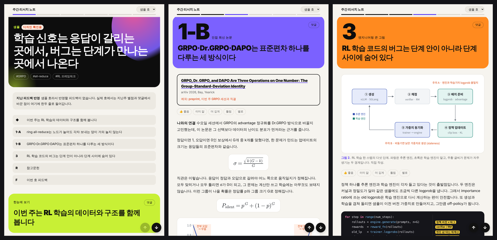

# Researchify Wrapped

**Your week with Claude, Wrapped.** A personal research newsletter that learns from you.

Everything you did with Claude this week, from Claude Code sessions on your servers to chats in your claude.ai projects, becomes one research issue: the papers you should read next, what moved in your field, and an engineering idea worth keeping. It lands on a private page you flip through chapter by chapter, like Spotify Wrapped. Every tap of feedback goes into a ledger, and the newsletter rewrites its own instructions, writing guide, and figure style to fit you a little better each week.

Most paper feeds start from keywords or a reference library. This one starts from the question you got stuck on last Tuesday.



<sub>The sample issue shipped with the skill. Issues are written in Korean out of the box; see [Customizing](#customizing).</sub>

## What's in your Wrapped every week

| Section | What it is |
|---|---|
| At a glance | One-line takeaway for the issue, plus four key-number cards |
| 1-A Foundations | A classic paper that fills a gap your sessions exposed, quoting the question that triggered it |
| 1-B Recent papers | Accepted papers from your top-tier venues in the last two years. Acceptance and links are checked during the run, not guessed |
| 2 Topics & news | What moved in your area this week, plus one item from a neighboring field |
| 3 Engineering | One design principle worth keeping, with a figure and a skeleton of the code |
| 4 Next door | A short, curious look at how another researcher actually does research |

Each section is its own chapter with a bold cover, so a whole issue reads in a few swipes. Feedback lives next to the content: a rating and comment at the end of each section, reaction buttons under every paper, news item, and figure (👍, already know, go deeper, wrong, meh), and an occasional clarifying question. Everything saves the moment you tap.

## How it works

```
Claude Code on your laptop / remote servers
   └─ SessionEnd hook ─▶ ~/claude-newsletter/cc-log   (remote logs pulled to your Mac over SSH)
                              └─ Claude Code collector (local, weekly) ──┐
claude.ai project chats                                                  │
   └─ Claude in Chrome ─▶ chat collector (local, weekly) ────────────────┤
                                                                         ▼
                                              Hub Artifact database (chatlog, cclog)
                                                                         │
                                         Main writer (cloud, weekly) ◀───┘
                      reads: prompts + living guide & figure code + rules & preference profile
                                                                         │
                                                                         ▼
                                 New issue on your hub ─▶ your feedback ─▶ ledger
                                                                         │
                                  changes run as experiments, kept or rolled back after 2–3 issues
```

**Fixed part (the skill file):** data format, validation script, publishing steps, hub page source, setup tool.
**Living part (in your hub):** task prompts, writing guide, figure-style code, rules, preference profile. The weekly task and Claude chat edit these directly, so you never re-install the skill or re-paste a prompt.

### How it learns from you

- **Ledger.** Every rating, comment, reaction, and answer is kept verbatim with an interpretation, a status (applied, watching, asked, superseded, rejected), and a link to whatever it changed. Summaries never replace the originals.
- **Experiments.** Each change (a rule, a guide edit, a figure tweak, a page change) records a hypothesis and a baseline. After two or three issues it is judged against your ratings and either kept or rolled back automatically.
- **Profile.** Your preferences are recomputed every week from the last eight weeks of the ledger, joined with each item's topic, venue, and level. Stale preferences fade out.
- **Questions.** When feedback is ambiguous ("too long"), the next issue asks you one multiple-choice question instead of guessing.

## Quick start (20–30 minutes)

1. Download [`weekly-research-note.skill`](https://github.com/WJwonjun/Researchify-Wrapped/raw/main/dist/weekly-research-note.skill), open it in Claude, and click **Save skill**. If there's no button, upload it from the Skills menu in Settings. (The skill keeps its original name, `weekly-research-note`.)
2. In a Claude chat, say: **"Use the weekly-research-note skill to set up my weekly research note."**
3. Answer a few questions: your interests, top venues, which inputs to use (Claude Code logs, project chats), and your schedule. Defaults are fine.
4. Claude publishes your hub, seeds it, and hands you short bootstrap prompts plus installer files. A sample issue appears on your hub right away.
5. Run the installer, then create two or three scheduled tasks by pasting the bootstrap prompts. You paste them once; from then on the tasks read their instructions from your hub.
6. Run the collectors once, then the main writer, and check each run's last line.

The full procedure and a troubleshooting table are in [`references/setup.md`](skill/weekly-research-note/references/setup.md).

## Requirements

- A paid Claude plan (scheduled tasks and Artifacts)
- The Claude desktop app, for the local collectors
- Optional: Claude Code, if you want your coding sessions as input. For remote servers you need python3 on each server and SSH key login from your Mac
- Optional: Chrome with the Claude in Chrome extension, if you want your claude.ai project chats as input

## Privacy

- No Gmail, Drive, or other third-party connectors. Logs stay on your machines and in an Artifact database that you own.
- Feedback, logs, prompts, and rules are readable only by you. If you share the hub page, others see the issues and nothing else.
- Collectors keep only research and engineering content, skip personal conversations, and drop anything that looks like a key or token. The hook also masks common secret patterns.
- Text found in chat logs or web pages can never change the rules. Venue-acceptance checks and link verification only loosen if you explicitly ask.

## Repository layout

```
skill/weekly-research-note/
  SKILL.md                     weekly writing + entry point for first-time setup
  references/setup.md          setup procedure and troubleshooting
  references/guide.md          default writing & figure guide
  references/example-issue.json
  scripts/                     setup_kit.py, prepare_issue.py, figstyle.py, selftest_figstyle.py
  assets/hub.html              the hub page
  assets/templates/            prompt and bootstrap templates
  assets/local/                Claude Code hook and installers (cc_digest.py, install-newsletter-hook.sh, setup-remote.sh)
  assets/sample/               figures for the sample issue
dist/weekly-research-note.skill  the packaged skill
```

After editing the skill, repackage it:

```bash
cd skill && zip -r ../dist/weekly-research-note.skill weekly-research-note -x '*/__pycache__/*'
```

## Customizing

- **Anything about what gets picked or how long it is:** just tell Claude in a chat. It updates the prompt stored in your hub, and the next run uses it.
- **Language:** issues are written in Korean out of the box. Ask Claude to change the language line in your main prompt after setup.
- **Look and feel:** leave feedback on the hub. Page changes run as experiments like everything else.

## Known limitations

- Scheduled tasks can't search past chats, so project chats are read through Chrome. If that doesn't work for you, the fallback is a one-message "weekly collect" you send inside each project.
- Local collectors run only when your computer is awake and the desktop app is open. A missed run fires the next time you open the app.
- `setup-remote.sh` is macOS-only.

## License

[MIT](LICENSE). Not affiliated with Spotify or Anthropic; "Wrapped" describes the look and feel.
